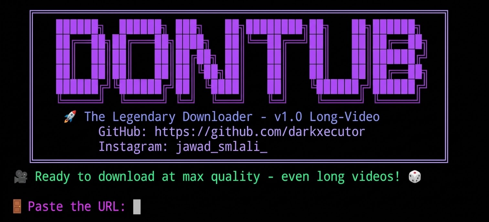
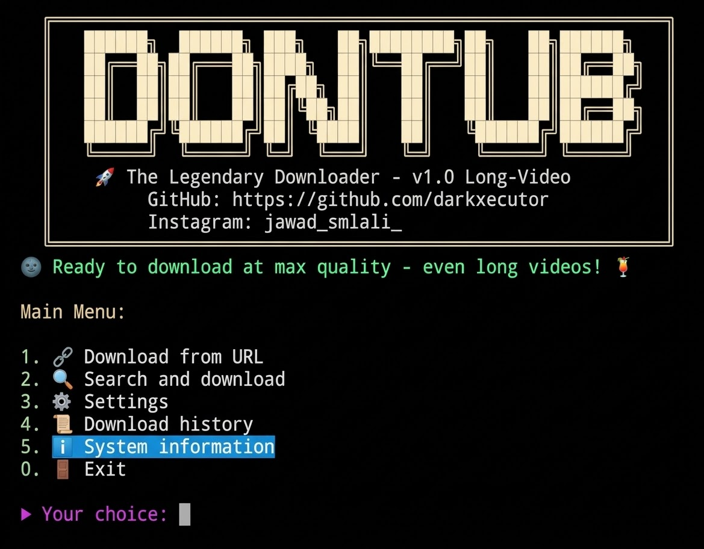

<div align="center">

<a href="https://github.com/darkxecutor/DONTUB-Pro">
    
</a>

<br><br>



<br><br>


</div>

---

<div align="center">

## 📺 فيديو شرح الأداة

[](https://youtu.be/YOUR_VIDEO_LINK_HERE)

> 🔗 **رابط الشرح:** [اضغط هنا لمشاهدة الفيديو](https://youtu.be/YOUR_VIDEO_LINK_HERE)

</div>

---

## 📖 نظرة عامة

**DONTUB Pro** هي أداة تحميل يوتيوب متطورة، محسّنة للفيديوهات الطويلة (**5+ ساعات**) بأعلى جودة ممكنة.
تعمل على **Termux** • **Pydroid 3** • **Acode** • **Linux** • **Windows**.

---

## 🖼️ معاينة القائمة

<div align="center">
    
</div>

### 🎯 القائمة الرئيسية

| # | الخيار | الوصف |
|:-:|--------|-------|
| **1** | 🔗 **Download from URL** | تحميل مباشر من رابط يوتيوب |
| **2** | 🔍 **Search and download** | بحث وتحميل من داخل الأداة |
| **3** | ⚙️ **Settings** | إعدادات المسار، الكوكيز، السرعة... |
| **4** | 📜 **Download history** | سجل التحميلات السابقة |
| **5** | ℹ️ **System information** | معلومات النظام والإصدارات |

---

## ✨ المميزات

- 🚀 تحميل بأعلى جودة (حتى 4K / 8K)
- 📥 دعم كامل للفيديوهات الطويلة (5+ ساعات)
- 🎵 استخراج الصوت MP3 بجودة 192kbps
- 🔍 بحث مباشر من داخل الأداة
- 📊 عرض جميع الصيغ المتاحة مع الأحجام
- 📜 سجل تحميلات قابل للمراجعة
- ⚙️ إعدادات محفوظة تلقائياً
- 🍪 دعم ملفات Cookies (للفيديوهات الخاصة)
- 🔔 إشعارات Termux
- 🎨 واجهة ملونة بإيموجيات عشوائية
- 🌐 تحميل متوازي (8 أجزاء افتراضياً)
- 💾 استئناف التحميلات المقطوعة

---

## 🛠️ Skills

<div align="center">

### 📱 Termux (Android)


</div>

```bash
# 1️⃣ تحديث الحزم
pkg update -y && pkg upgrade -y

# 2️⃣ تثبيت Python و FFmpeg
pkg install python ffmpeg git -y

# 3️⃣ تثبيت yt-dlp
pip install -U "yt-dlp[default]"

# 4️⃣ تنزيل الأداة
git clone https://github.com/darkxecutor/DONTUB-Pro.git
cd DONTUB-Pro

# 5️⃣ منح إذن التخزين (مرة واحدة فقط)
termux-setup-storage

# 6️⃣ تشغيل الأداة
python dontub.py
```

<div align="center">

🐧 Kali Linux


</div>

```bash
# 1️⃣ تحديث النظام
sudo apt update && sudo apt upgrade -y

# 2️⃣ تثبيت المتطلبات
sudo apt install python3 python3-pip ffmpeg git -y

# 3️⃣ تثبيت yt-dlp
pip3 install -U "yt-dlp[default]"

# 4️⃣ تنزيل الأداة
git clone https://github.com/darkxecutor/DONTUB-Pro.git
cd DONTUB-Pro

# 5️⃣ تشغيل الأداة
python3 dontub.py
```

<div align="center">

🪟 Windows


</div>

```powershell
# 1️⃣ تثبيت Python من: https://www.python.org/downloads/
# 2️⃣ تثبيت FFmpeg من: https://ffmpeg.org/download.html
#     (فك الضغط + أضف المجلد لـ PATH)

# 3️⃣ تثبيت yt-dlp
pip install -U "yt-dlp[default]"

# 4️⃣ تنزيل الأداة
git clone https://github.com/darkxecutor/DONTUB-Pro.git
cd DONTUB-Pro

# 5️⃣ تشغيل الأداة
python dontub.py
```

---

📂 هيكل المشروع

```
DONTUB-Pro/
├── dontub.py              # الملف الرئيسي للأداة
├── README.md              # هذا الملف
└── images/
    ├── logo.jpg           # صورة القائمة الرئيسية
    └── logo1.jpg          # شعار الأداة
```

---

🎯 طريقة الاستخدام

بعد تشغيل الأداة، ستظهر لك القائمة الرئيسية:

```
1. 🔗 Download from URL      → الصق رابط يوتيوب
2. 🔍 Search and download    → ابحث باسم الفيديو
3. ⚙️  Settings              → عدّل الإعدادات
4. 📜 Download history       → شاهد سجل التحميلات
5. ℹ️  System information    → معلومات النظام
0. 🚪 Exit                   → خروج
```

🎬 خيارات الجودة

```
1 - Best quality (4K/8K) 🎬
2 - 1080p 🎥
3 - 720p 📺
4 - 480p 📱
5 - 360p 📲
6 - MP3 (audio only) 🎵
7 - Show all formats 📊
0 - Back ⬅️
```

---

⚠️ ملاحظات مهمة

· 📦 FFmpeg ضروري لدمج الفيديو مع الصوت
· 💾 تأكد من المساحة الفارغة — الأداة تحتاج ضعف حجم الفيديو مؤقتاً
· 🍪 للفيديوهات الخاصة — استعمل ملف cookies.txt من الإعدادات
· 🐌 في حالة خطأ 403 — حدّث yt-dlp: pip install -U yt-dlp
· 🐢 للفيديوهات الطويلة — لا تغلق الأداة حتى يكتمل الدمج

---

🧪 استكشاف الأخطاء

المشكلة الحل
yt-dlp not installed pip install -U "yt-dlp[default]"
FFmpeg missing pkg install ffmpeg (Termux)
No space left on device امسح ملفات *.part من مجلد التحميلات
HTTP Error 403 pip install -U yt-dlp
Private video أضف cookies.txt من الإعدادات
Sign in required الفيديو يحتاج تسجيل دخول — استعمل cookies

---

📜 الترخيص

هذا المشروع مرخص تحت MIT License — راجع ملف LICENSE للتفاصيل.

---

<div align="center">

👨‍💻 المطور

Darkxecutor

https://img.shields.io/badge/GitHub-darkxecutor-6A0DAD?style=for-the-badge&logo=github&logoColor=white
https://img.shields.io/badge/Instagram-jawad__smlali__-E4405F?style=for-the-badge&logo=instagram&logoColor=white


<br>

⭐ إذا أعجبتك الأداة، لا تنسَ إضافة نجمة للمستودع! ⭐

</div>
```
